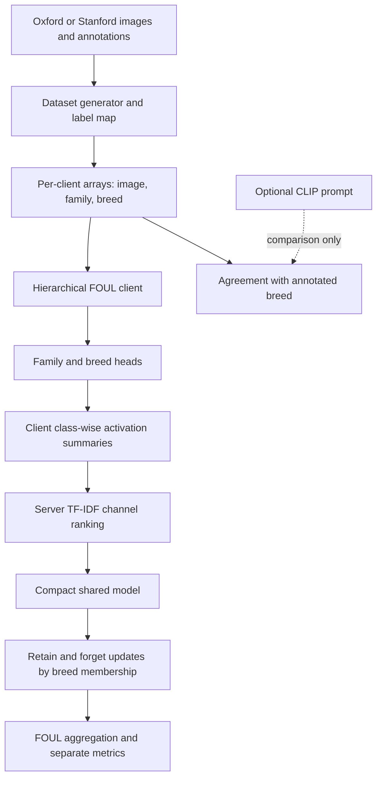

# Fine-Grained Federated Unlearning for Pet Breeds Design

**Spec**: `.specs/features/semantic-subclass-pruning/spec.md`  
**Status**: Approved on 2026-11-25 with the user's approval of the design and tasks.

## Architecture Overview

Use a feature-specific hierarchical dataset path and FOUL client/server behavior so existing single-label datasets continue to use their current `(image, label)` contract. Oxford samples carry a family ID and breed ID. Stanford samples carry parent `dog` and breed ID. A shared convolutional model returns separate family and breed logits. During ordinary learning, it trains both heads. During unlearning, target breed examples still train the family objective, while their breed-head updates enter FOUL's forget group. Other breed updates enter FOUL's retain group. Before those rounds, clients report class-wise channel activation summaries; the server uses the paper's TF-IDF score to remove 50% of eligible target-discriminative channels and synchronizes the physically compact model.



### Approach choice

| Approach | Trade-off | Decision |
| --- | --- | --- |
| Shared feature extractor with family and breed heads | One representation is shared; family metrics remain meaningful while breed-specific learning can be separated. Requires explicit tuple/dict output handling in FOUL. | Selected in the user-approved spec. |
| Two independent models, one family and one breed | Easy loss isolation but duplicates compute, parameters, pruning work, and synchronization. | Rejected for the compact-model goal. |
| One 37-way breed head with family metrics derived by mapping breeds | Minimal model change, but the target breed is just an ordinary output class and the family task cannot be trained independently. | Rejected because it does not demonstrate parent retention separately. |

## Code Reuse Analysis

### Existing Components to Leverage

| Component | Location | How to Use |
| --- | --- | --- |
| Per-client NPZ dataset format and config writing | `dataset/utils/dataset_utils.py` | Reuse the existing storage convention where practical; add a feature-specific schema for the second label. |
| Single-label client reader | `system/utils/data_utils.py` | Keep unchanged for current datasets; add a hierarchical reader in a separate module for Oxford/Stanford FOUL. |
| CNN building blocks | `system/flcore/trainmodel/models.py` | Reuse the existing convolutional design as reference; implement a feature model with an explicit shared feature method and two heads. |
| FOUL client training lifecycle | `system/flcore/clients/clientfoul.py` | Reuse round/timing and optimizer conventions; add explicit family/breed losses and sample-group updates for the new datasets. |
| FOUL server lifecycle and hypergradient optimizer | `system/flcore/servers/serverfoul.py` | Reuse learning rounds and `foul_update`; add a hierarchy-specific aggregation path. |
| Dataset/model/algorithm selection | `system/main.py` | Add dataset names, breed target options, optional CLIP flag, and avoid wrapping the two-head model in `BaseHeadSplit`. |

### Integration Points

| System | Integration Method |
| --- | --- |
| Dataset files | One dataset command writes Oxford or Stanford image arrays, family IDs, breed IDs, and deterministic label maps. |
| Client loading | New hierarchy-aware loader selected only for `OxfordPet` and `StanfordDogs`; existing dataset loaders remain unchanged. |
| Training | New model outputs `family_logits` and `breed_logits`; FOUL client computes the corresponding losses. |
| Unlearning | Target breed is selected from metadata per sample; server aggregates per-client retain/forget updates rather than classifying entire clients by ID. |
| Pruning | A new utility obtains ReLU + spatial-average channel activations at each eligible feature layer; clients send only class-wise averages. |
| Checkpoints | Save the compact model only after structure synchronization and shape checks succeed; preserve the original checkpoint on failure. |

## Components

### Hierarchical dataset reader

- **Purpose**: Read per-client images, family labels, and breed labels without changing generic client-data contracts.
- **Location**: `system/utils/hierarchical_data.py`
- **Interface**: `read_hierarchical_client_data(dataset, client_id, is_train)` returns image tensors and two integer label tensors.
- **Dependencies**: NumPy, PyTorch, existing `dataset/<name>/{train,test}` NPZ files.
- **Reuses**: NPZ conventions from `system/utils/data_utils.py`.

### Oxford and Stanford generators

- **Purpose**: Convert source layouts and official annotations/splits into the shared per-client hierarchy schema.
- **Location**: `dataset/generate_pet_datasets.py`
- **Interface**: CLI generators accept client count, partition mode, seed, and dataset root; Oxford preserves the official test set and combines official train/validation for federated train data.
- **Dependencies**: torchvision dataset support for Oxford; local Stanford Dogs directory and official split lists for Stanford.
- **Reuses**: `dataset/utils/dataset_utils.py` storage/config conventions; custom deterministic allocation keeps both labels aligned.

### Hierarchical classifier

- **Purpose**: Produce family and breed logits from a common feature representation.
- **Location**: `system/flcore/trainmodel/hierarchical_cnn.py`
- **Interface**: `forward(images) -> (family_logits, breed_logits)` and `feature_layers()` exposes eligible structured-pruning layers.
- **Dependencies**: PyTorch.
- **Reuses**: Existing `FedAvgCNN` convolutional pattern without its single-output head or `BaseHeadSplit` adapter.

### FOUL client and server path

- **Purpose**: Train both heads normally, then during unlearning retain family loss on every image and separate breed-head deltas by target membership.
- **Location**: `system/flcore/clients/clientfoul.py`, `system/flcore/servers/serverfoul.py`
- **Interface**: Client exposes family/breed training, activation summaries, and per-round retain/forget model deltas; server aggregates non-empty groups through FOUL and evaluates family, target breed, and remaining breeds separately.
- **Dependencies**: Hierarchical reader/model and the existing `foul_update` optimizer.
- **Reuses**: Existing client local-epoch and server round lifecycle. Legacy datasets keep the existing client-ID behavior.

### Class-discriminative pruning

- **Purpose**: Use federated activation summaries and the FCUP TF-IDF formula to physically shrink the shared feature extractor before FOUL.
- **Location**: `system/flcore/servers/foul_pruning.py`
- **Interface**: `prune_model(model, class_activation_summaries, target_breed, pruning_rate=0.5)` returns a compact model plus per-layer counts.
- **Dependencies**: PyTorch, NumPy.
- **Reuses**: No generic PUMA reconstruction code; the score follows FCUP, with model-specific dependency-aware tensor slicing.

### Optional CLIP comparison

- **Purpose**: Compare prompt-selected image/cluster membership with Oxford's annotated breed labels without changing the ground-truth forget set.
- **Location**: `system/utils/clip_breed_compare.py`
- **Interface**: Given image paths/tensors and a prompt, return selected indices and agreement statistics; only imported when its CLI flag is enabled.
- **Dependencies**: Optional `open_clip_torch` installation and cached/downloadable CLIP weights.
- **Reuses**: Oxford/Stanford label maps and the user's confirmed prompt-selection comparison.

## Data Models

### Per-client image record

```python
{
    "x": uint8_images,            # [N, H, W, 3]
    "y": int64_family_ids,        # Oxford: cat/dog; Stanford: all dog
    "y_subclass": int64_breed_ids # stable dataset-specific IDs
}
```

### Dataset config

- `num_clients`, `dataset`, `family_to_idx`, `breed_to_idx`, `parent_by_breed`, train/test sample counts, partition mode, and seed.
- Oxford breed IDs cover the 37 annotated breeds; Stanford IDs cover its 120 breed directories. IDs are stable within each dataset, not shared across datasets.
- Store images as uint8 and normalize to float tensors in the hierarchy reader to limit disk use.

### Model output

```python
(family_logits, breed_logits)
```

Oxford has two family logits and 37 breed logits. Stanford has a constant dog parent label and 120 breed logits; parent accuracy is omitted.

## Error Handling Strategy

| Error Scenario | Handling | User Impact |
| --- | --- | --- |
| Invalid dataset or breed target | Reject before loading/saving a checkpoint and list valid names. | Correct the CLI target. |
| Source dataset or split files missing | Report the exact expected path and dataset preparation command. | Prepare or point to the dataset root. |
| Empty target/retain group across all selected clients | Abort the unlearning round with per-client counts; do not overwrite the trained checkpoint. | Change target or partition. |
| Optional CLIP dependency or weights unavailable | Fail only the CLIP comparison request with an install/cache message; normal label-based runs still work. | Install optional package or disable comparison. |
| Structural pruning produces invalid tensor shapes | Validate every dependent layer and both output heads before synchronization/checkpoint replacement. | Keep the original model and report the layer. |
| A client has an empty local target or retain subgroup | Omit that subgroup update for that client; continue if the global group is non-empty. | No manual action. |

## Risks & Concerns

| Concern | Location | Impact | Mitigation |
| --- | --- | --- | --- |
| Current dataset reader exposes only one label and client/server code assumes `(x, y)`. | `system/utils/data_utils.py`, `system/flcore/clients/clientfoul.py` | Broad changes could break all current datasets. | Add a separate hierarchy reader and gate the new behavior on the new dataset names. |
| Current `BaseHeadSplit` assumes one `.head` and pads/truncates features. | `system/flcore/trainmodel/models.py`, `system/main.py` | It cannot safely wrap an explicit two-head model. | Do not wrap the hierarchy model; use its explicit output only for these datasets. |
| FOUL aggregation currently puts entire clients into forget or retain groups and expects one update per client. | `system/flcore/servers/serverfoul.py` | Mixed target/retain samples on one client cannot be expressed. | Add an isolated hierarchy aggregation path with one update per non-empty sample group. |
| FCUP's reference prunes target-discriminative channels, then fine-tunes on target-excluded data; this feature instead runs FOUL on the compact model. | `serverfoul.py` | The combined method is an adaptation, not a reproduction of the paper's complete pipeline. | Record the deviation and report both pruning-only and post-FOUL metrics. |
| Oxford is small for 20 clients and some client partitions may have only a few target examples. | Oxford generator/client data | Target updates may be sparse or uneven. | Print per-client counts, deterministic partitioning, and omit only local empty groups. |
| Removing 50% of channels can reduce family and non-target breed accuracy. | `foul_pruning.py` | Compactness can come at the cost of retained utility. | Preserve both heads, report pre/post-pruning metrics, and enforce at least one channel per eligible layer. |
| No project tests or quality commands were found. | Repository root | Automated regression coverage is absent. | Do not add or run tests under the current instruction; use source-level review and Python syntax compilation only, and clearly report this limitation. |

## Tech Decisions

| Decision | Choice | Rationale |
| --- | --- | --- |
| Architecture | One CNN trunk with family and breed heads. | Keeps compute and compact parameter count lower than two independent models and follows the approved spec. |
| Dataset serialization | uint8 per-client NPZ with family and breed vectors. | Keeps image storage reasonable and allows use of current NPZ conventions. |
| Model interface | Explicit tuple output, no `BaseHeadSplit` wrapper. | Avoids current single-head assumptions and ambiguous feature padding. |
| Unlearning group granularity | Per-sample breed membership; separate local group updates. | A target breed may coexist with retained examples on every client. |
| Pruning score | FCUP client class-wise average activations + server TF-IDF; top 50% per eligible layer. | Follows the selected paper and user-selected pruning rate. |
| CLIP dependency | Optional lazy dependency, label-based path works without it. | Keeps standard Oxford/Stanford experiments installable without CLIP. |

> **Project-level decisions:** None; these choices are feature-local.
